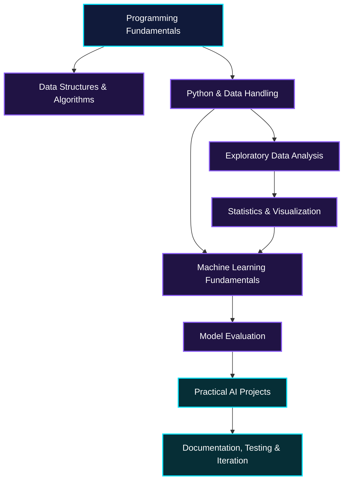

<!--
╔══════════════════════════════════════════════════════════════╗
║  GITHUB PROFILE README — Mohammed Hashim (@mxl-ed)           ║
║  Theme: Cyberpunk | Neon Cyan + Violet | Focus: AI           ║
╚══════════════════════════════════════════════════════════════╝
-->

<div align="center">

<!-- ANIMATED CYBER BANNER -->


<!-- ANIMATED TYPING INTRO -->
<a href="https://github.com/mxl-ed">
  
</a>

<br/>

<a href="https://github.com/mxl-ed?tab=repositories">
  
</a>
<a href="https://github.com/mxl-ed?tab=stars">
  
</a>
<a href="https://github.com/mxl-ed?tab=followers">
  
</a>

<br/><br/>


</div>

---

## `01 // SYSTEM PROFILE`

```text
USER       : Mohammed Hashim
HANDLE     : @mxl-ed
INTEREST   : Artificial Intelligence
MODE       : Learn • Build • Experiment • Improve
OBJECTIVE  : Turn ideas into useful technology
PHILOSOPHY : Progress through consistent effort
```

Hello! I'm **Mohammed Hashim**, a technology enthusiast interested in artificial intelligence, programming, data, and creative problem-solving.

I enjoy exploring how technology works, learning new concepts, and finding ways to turn complicated ideas into practical solutions. I'm interested in the intersection of AI, software development, data analysis, and real-world applications.

This profile is my evolving workspace: a place to document what I learn, experiment with ideas, develop projects, and improve one step at a time.

> The goal isn't to look like an expert. The goal is to keep learning until I can build things that matter.

### `CURRENT MISSION`

- [ ] Strengthen programming fundamentals and problem-solving.
- [ ] Develop a solid foundation in artificial intelligence and machine learning.
- [ ] Improve Python, data handling, and visualization skills.
- [ ] Build and document practical, meaningful projects.
- [ ] Learn how to evaluate models and understand their limitations.
- [ ] Improve code quality, documentation, testing, and version control.
- [ ] Turn learning experiments into reproducible projects.

*These are learning goals, not claims of completed achievements.*

---

## `02 // AREAS OF INTEREST`

<div align="center">

<table>
<tr>
<td width="50%" valign="top">

### 🤖 Artificial Intelligence

Exploring how intelligent systems learn from data, recognize patterns, and assist with real-world problems.

- Machine learning fundamentals
- Model evaluation and experimentation
- AI-assisted applications
- Responsible and practical AI

</td>
<td width="50%" valign="top">

### 🧠 Problem Solving

Learning to break complex problems into smaller, understandable steps.

- Algorithms and logic
- Debugging and optimization
- Analytical thinking
- Writing maintainable solutions

</td>
</tr>
<tr>
<td width="50%" valign="top">

### 📊 Data & Visualization

Turning raw data into information that people can understand.

- Data cleaning
- Exploratory data analysis
- Statistical reasoning
- Charts and visual storytelling

</td>
<td width="50%" valign="top">

### 💻 Software Development

Building a stronger foundation for creating reliable applications.

- Python and programming fundamentals
- Git and GitHub
- APIs and automation
- Documentation and testing

</td>
</tr>
</table>

</div>

---

## `03 // TECHNOLOGY STACK`

<div align="center">

### Languages & Programming

<a href="https://www.python.org/"></a>
<a href="https://isocpp.org/"></a>
<a href="https://www.java.com/"></a>
<a href="https://www.mathworks.com/products/matlab.html"></a>

### AI, Machine Learning & Data

<a href="https://numpy.org/"></a>
<a href="https://pandas.pydata.org/"></a>
<a href="https://matplotlib.org/"></a>
<a href="https://scikit-learn.org/"></a>
<a href="https://pytorch.org/"></a>
<a href="https://www.tensorflow.org/"></a>

### Development Tools

<a href="https://git-scm.com/"></a>
<a href="https://github.com/"></a>
<a href="https://code.visualstudio.com/"></a>
<a href="https://jupyter.org/"></a>
<a href="https://colab.research.google.com/"></a>

</div>

> **Stack note:** These badges indicate technologies relevant to this profile's learning direction. Keep only the tools you actually use or are currently learning, and remove any that don't reflect your experience.

---

## `04 // PROJECT LAB`

This section is designed to grow as real projects are added. The entries below are **project ideas and editable slots**, not claims that these projects are already complete.

<table>
<tr>
<td width="50%" valign="top">

### 🚦 AI-Based Traffic Management

**Status:** Idea / development placeholder

Explore how data and machine learning could support traffic analysis and signal optimization.

**Potential components**

- Traffic data processing
- Vehicle-count analysis
- Congestion visualization
- Model evaluation and limitations

**Possible stack:** Python, data analysis, computer vision, machine learning.

[View projects →](https://github.com/mxl-ed?tab=repositories)

</td>
<td width="50%" valign="top">

### 📈 Financial Data Explorer

**Status:** Learning project idea

Explore financial datasets and communicate their patterns through clear visualizations.

**Potential components**

- Missing-value analysis
- Outlier investigation
- Exploratory data analysis
- Interactive charts and conclusions

**Possible stack:** Python, Pandas, NumPy, Matplotlib.

[View projects →](https://github.com/mxl-ed?tab=repositories)

</td>
</tr>
<tr>
<td width="50%" valign="top">

### 🧪 Machine Learning Playground

**Status:** Future experiment

A place to compare models, investigate their behavior, and learn why evaluation matters.

**Potential components**

- Dataset preparation
- Baseline models
- Train/test separation
- Metrics and error analysis

**Possible stack:** Python, Scikit-learn, Jupyter.

[Explore repositories →](https://github.com/mxl-ed?tab=repositories)

</td>
<td width="50%" valign="top">

### 🛠️ Developer Productivity Toolkit

**Status:** Future experiment

Small scripts and utilities that make repetitive development or data tasks easier.

**Potential components**

- File and data automation
- Reusable Python functions
- Input validation
- Usage documentation and tests

**Possible stack:** Python, Git, command-line tools.

[Explore repositories →](https://github.com/mxl-ed?tab=repositories)

</td>
</tr>
</table>

### Add a real project

When a project is ready, replace one of the placeholders with:

- **Problem:** What does it address?
- **Solution:** What did you implement?
- **Technology:** What tools did you use?
- **Evidence:** What results can you demonstrate?
- **Limitations:** What still needs improvement?
- **Repository:** A direct link to the actual code.

---

## `05 // GITHUB TELEMETRY`

<div align="center">

<!-- GITHUB STATISTICS -->


<br/>

<!-- CONTRIBUTION STREAK -->


<br/>

<!-- ACTIVITY GRAPH -->


<br/>

<!-- TROPHIES -->


</div>

<details>
<summary><b>How to read these statistics</b></summary>

- **Profile statistics:** A summary of activity recognized by the stats service.
- **Top languages:** A rough breakdown of languages in public repositories; it is not a measure of skill.
- **Contribution streak:** A display of recorded contribution activity.
- **Activity graph:** A visual timeline of recognized contributions.
- **Trophies:** Badges provided by an external service based on its own rules.

These widgets depend on third-party services and may load slowly, show incomplete data, or temporarily stop working. Private contributions and service-specific counting rules can affect the results.

</details>

---

## `06 // CONTRIBUTION MATRIX`

<div align="center">

<!-- Generated by the GitHub Actions snake workflow -->


*Small contributions. Consistent learning. Continuous improvement.*

</div>

If the animation does not appear initially, configure the workflow in `.github/workflows/snake.yml`. The snake requires a GitHub Actions workflow to generate and publish its SVG.

---

## `07 // MY LEARNING ROADMAP`



### Learning checklist

- [ ] Build confidence with programming fundamentals.
- [ ] Write readable code and meaningful commit messages.
- [ ] Understand data structures, algorithms, and complexity.
- [ ] Practice data cleaning and exploratory analysis.
- [ ] Understand training, validation, and testing.
- [ ] Learn model evaluation metrics and common pitfalls.
- [ ] Build projects with reproducible instructions.
- [ ] Document assumptions, results, and limitations.
- [ ] Review older work and improve it with new knowledge.

*The roadmap is intentionally a work in progress. Check items as you genuinely complete them.*

---

## `08 // ENGINEERING PRINCIPLES`

<table>
<tr>
<td align="center" width="25%">

### 🧩

**Understand**

Break the problem down before writing the solution.

</td>
<td align="center" width="25%">

### 🔬

**Experiment**

Test ideas and learn from evidence.

</td>
<td align="center" width="25%">

### 🧹

**Refine**

Make code clearer, simpler, and more reliable.

</td>
<td align="center" width="25%">

### 📚

**Document**

Make the work understandable and reproducible.

</td>
</tr>
</table>

### My approach to a technical problem

```python
def solve_problem(problem):
    """
    A conceptual workflow for approaching a problem.
    Replace this example with a real implementation
    when building a project.
    """

    # 1. Understand the problem and constraints.
    requirements = understand(problem)

    # 2. Divide it into manageable parts.
    smaller_tasks = decompose(requirements)

    # 3. Build a simple, testable solution.
    solution = implement(smaller_tasks)

    # 4. Check the behavior and edge cases.
    results = test(solution)

    # 5. Learn from the results and improve.
    improved_solution = refine(solution, results)

    return improved_solution
```

> This is pseudocode illustrating a problem-solving mindset, not a ready-to-run Python implementation.

---

## `09 // OPEN SOURCE & COLLABORATION`

I'm interested in learning from well-documented projects, understanding how developers collaborate, and eventually contributing useful improvements to open-source software.

Areas I'd like to explore:

- Reading other people's code to understand design decisions.
- Reporting reproducible bugs and writing useful issue descriptions.
- Improving documentation and examples.
- Contributing focused fixes with appropriate tests.
- Learning how projects handle reviews, releases, and maintenance.

If you maintain a project related to AI, Python, data analysis, or developer tools, feel free to share it with me.

---

## `10 // INSPIRATION TERMINAL`

<div align="center">


<br/><br/>


### `KEEP BUILDING. KEEP LEARNING.`

**Curiosity is the beginning. Consistency is the process. Improvement is the direction.**

</div>

---

## `11 // CONNECT`

<div align="center">

<a href="https://github.com/mxl-ed">
  
</a>
<a href="https://www.linkedin.com/in/mohammed-hashim-065b3b425">
  
</a>
<a href="mailto:mohammedalhashimi788@gmail.com">
  
</a>

<br/><br/>

**Have an idea, a useful resource, or an interesting technical challenge?**

Let's learn something new and build something worthwhile.

<br/>

<a href="https://www.linkedin.com/in/mohammed-hashim-065b3b425">Connect with me on LinkedIn →</a>

<br/>

<a href="mailto:mohammedalhashimi788@gmail.com">Send me an email →</a>

</div>

<div align="center">


<sub>Designed with curiosity • Maintained through learning • Powered by GitHub</sub>

</div>
